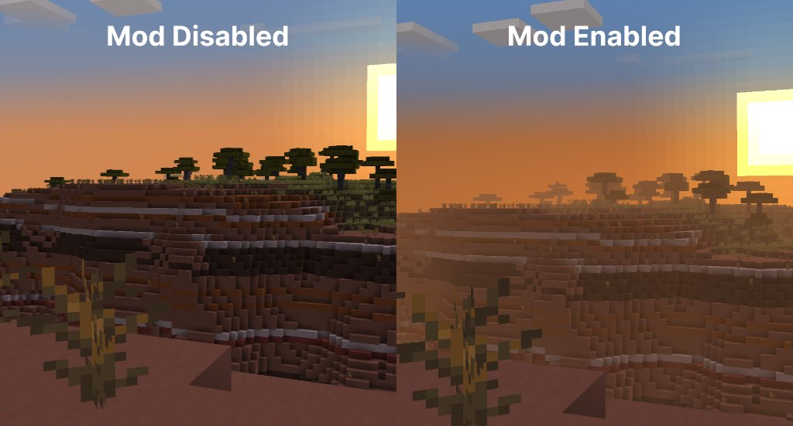
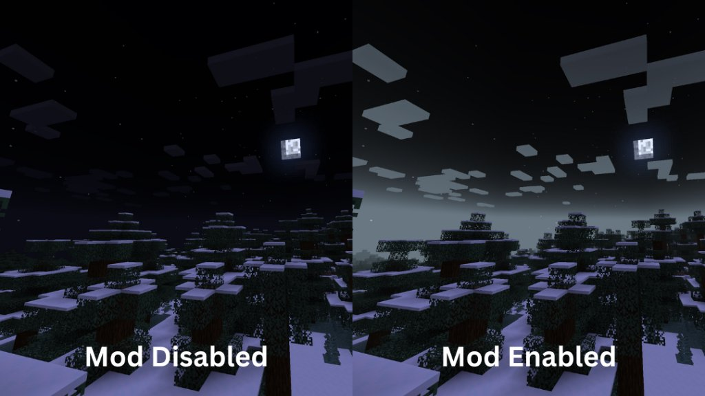
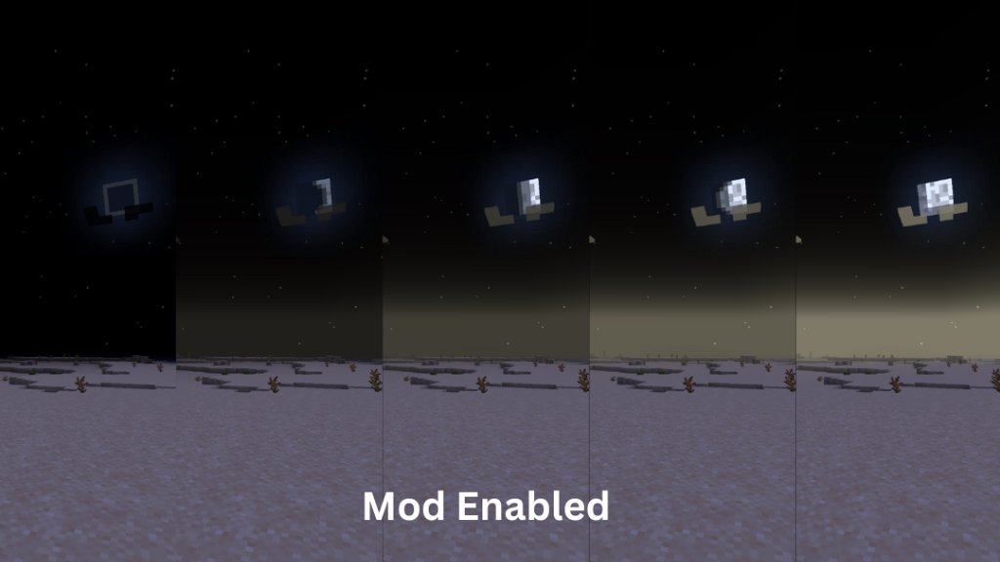
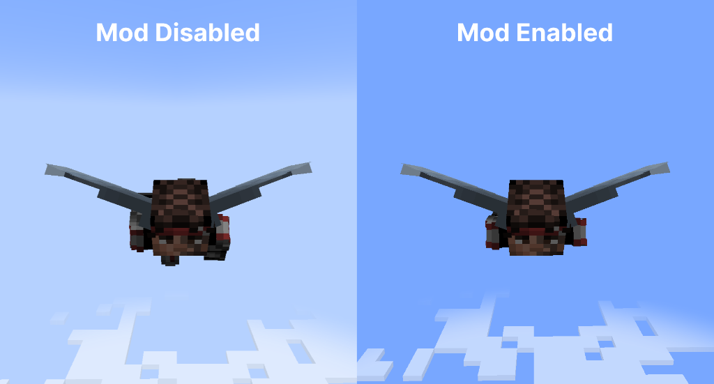
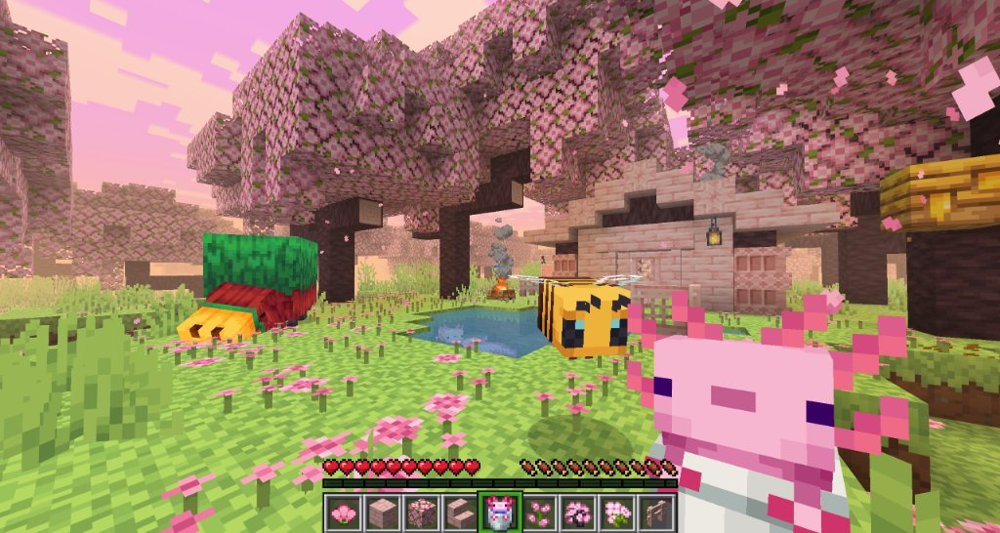
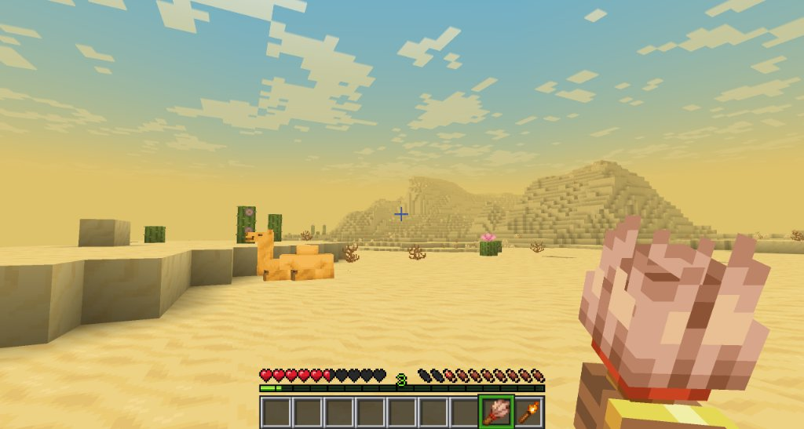
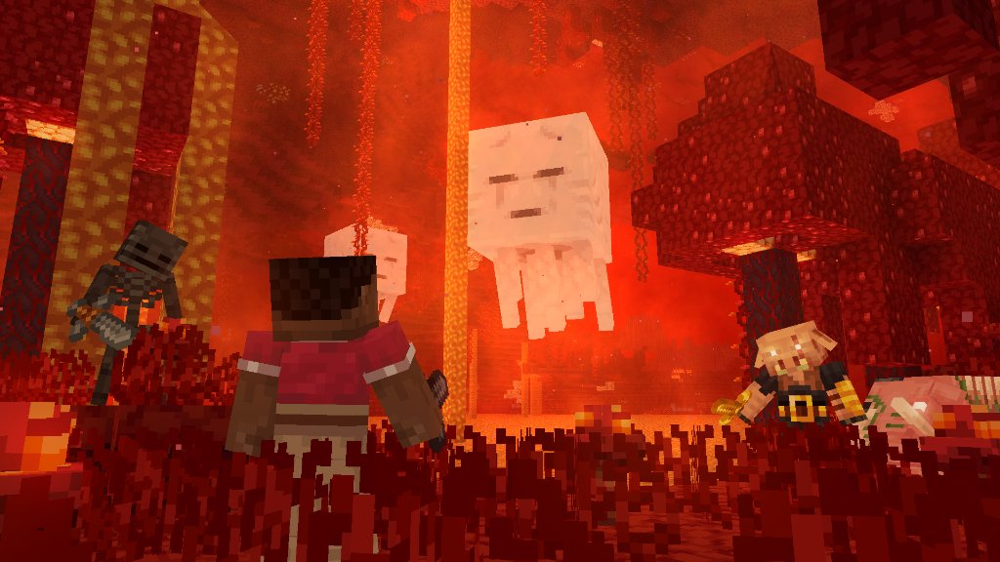
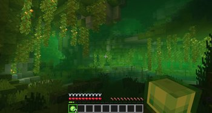

# AMBIENT MODS

> NOTE
> Ambient mods enhance the environmental mood, horizon, sky, and depth of the Minecraft world without overhauling core mechanics.

> TIP
> Most of the mods listed here are Fabric / NeoForge client-side mods. Download the `.jar` file from Modrinth and place it into your `mods` folder.

## 1. Fog

- Completely revamps how Minecraft handles fog rendering to provide depth and atmosphere.
- Features dynamic cave fog that thickens progressively as you venture deeper underground, creating a spooky and immersive cave exploration experience.
- Dynamically adjusts fog density and coloring based on current weather, time of day (sunsets, sunrises), moon phases, and biome transitions.
- Highly configurable and preserves render distance while eliminating harsh horizon cutoff lines.

> NOTE
> The above pictures are from Modrinth showcasing the visual difference with Fog disabled vs enabled.

Download :  [Fog](https://modrinth.com/mod/fog)

## 2. Atmospherics

- Modifies environmental and atmospheric horizon parameters dynamically in real time.
- Changes sky colors, clouds, horizon haze, and star visibility based on the specific biome you inhabit.
- Gives distinct atmospheric personalities to arid deserts, dense jungles, snowy peaks, and oceanic horizons.

> NOTE
> The above pictures are from Modrinth showcasing biome-specific skies, fog, and environmental tints.

Tag : `[AI Generated Code]` *(Declared on Modrinth: Contains AI-assisted / generated code for development, with all visual assets and concepts created manually)*

Download :  [Atmospherics](https://modrinth.com/mod/atmospherics)

---

## Related

- [Atmosphere overview](overview.md)
- [Weather](weather.md)
- [Particles](particles.md)
