# PARTICLE MODS

> NOTE Particle mods add environmental motes, physical interaction effects, and cosmetic ambient touches to make the Minecraft world feel vibrant and alive.

> TIP Most particle mods are lightweight and fully client-side. Make sure you don't stack conflicting mods with duplicate effects, or disable overlapping particle types in their respective config menus.

## 1. Particular Reforged

* Adds a wide array of hand-crafted visual particle effects throughout the world.
* Introduces cascading waterfall mist and white foam where water flows into lakes and rivers.
* Adds water and lava splash crowns whenever entities or projectiles fall into fluids.
* Fills biomes with organic environmental touches like warm-evening fireflies, floating cave dust in deep caverns, cold breath vapor, and leaves drifting from trees.

Download :  [Particular Reforged](https://modrinth.com/mod/particular-reforged)

## 2. Subtle Effects

* Overhauls environmental ambience by adding dozens of small, delightful particle details.
* Features sleeping "Z" particles rising from resting villagers and players.
* Adds realistic dust clouds when sprinting, jumping, landing from heights, or riding mounts.
* Displays sparks around campfires and burning entities, leaves floating from tree canopies, and sticky slime trails behind moving slimes.

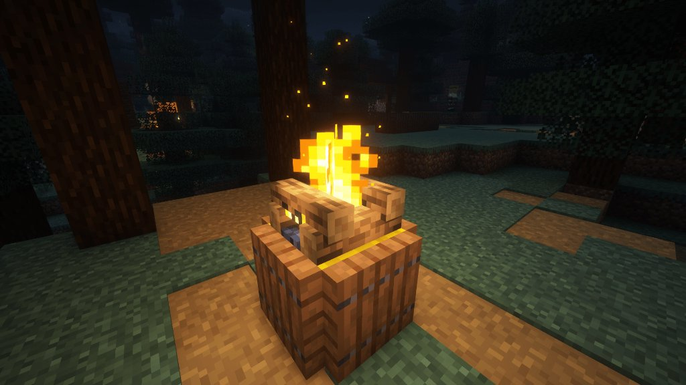

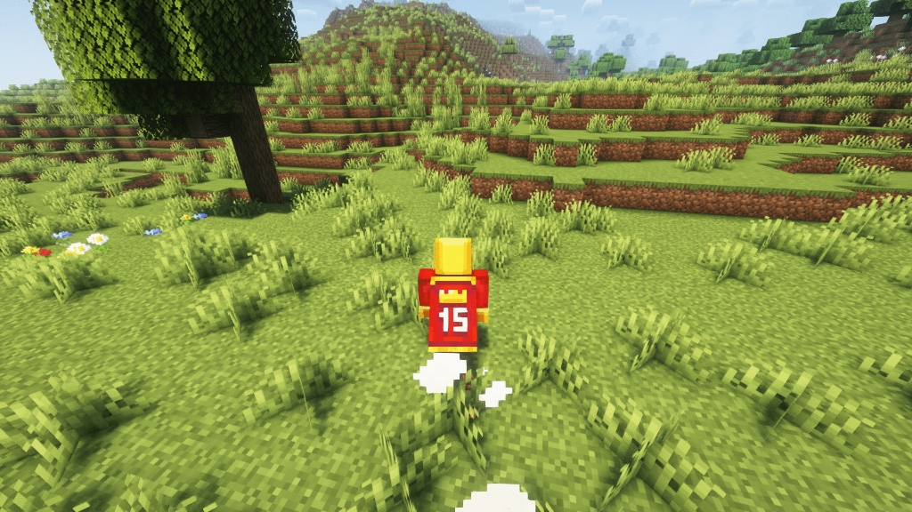

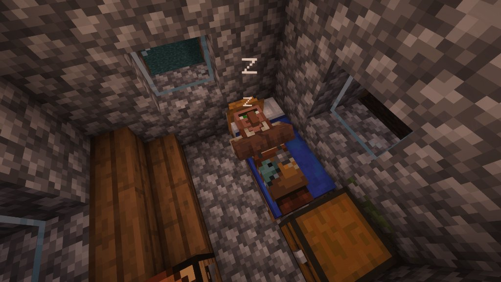

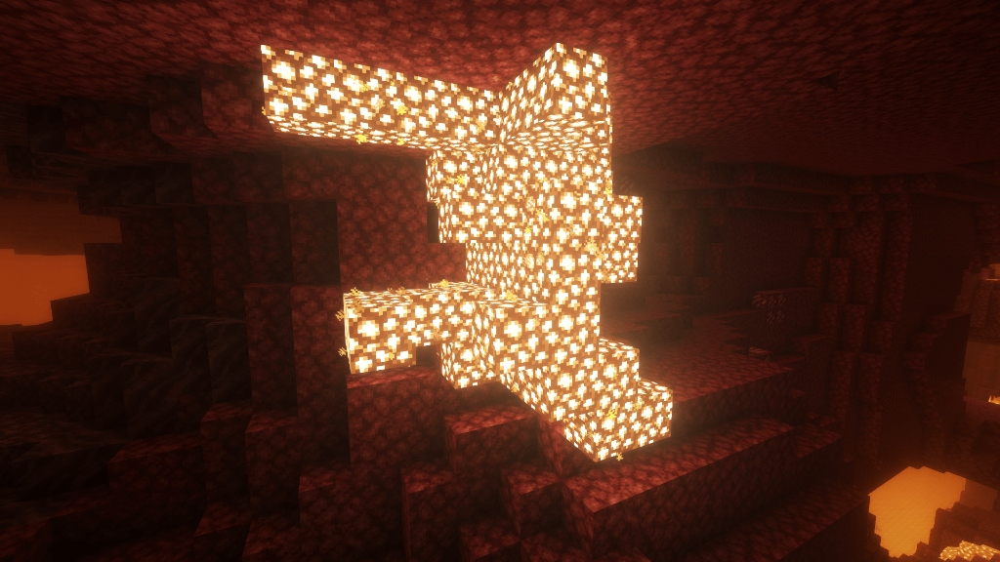

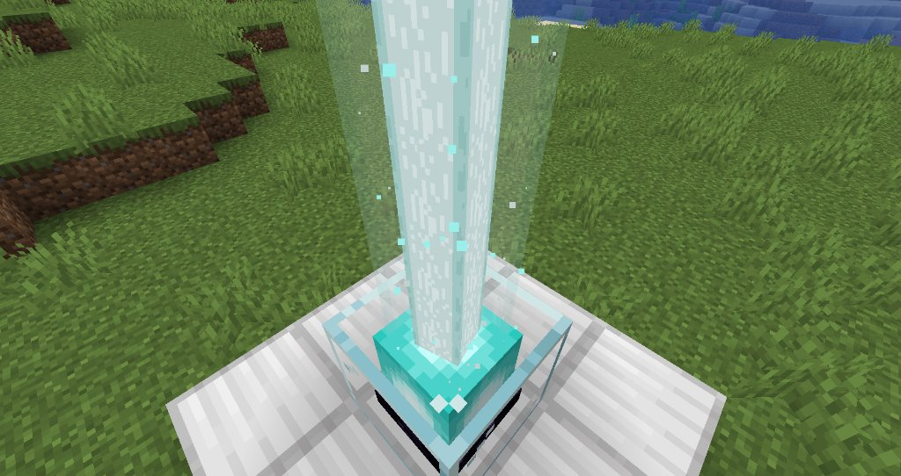

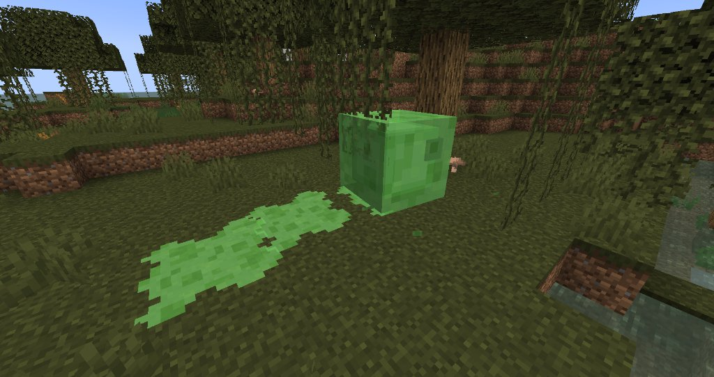

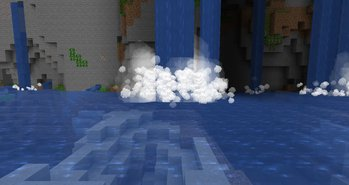

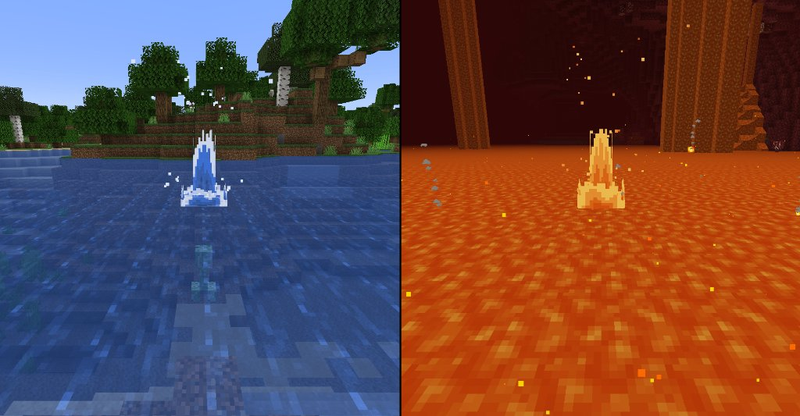

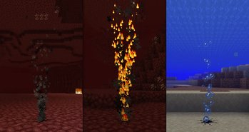

> NOTE The above pictures are from Modrinth showcasing ambient particle additions from Subtle Effects.

Download :  [Subtle Effects](https://modrinth.com/mod/subtle-effects)

## 3. Effectual

* A collection of immersion-focused micro-particles and subtle aesthetic enhancements.
* Emits visible breath vapor and steam from characters in cold and frozen biomes.
* Displays underwater air bubbles escaping when opening submerged storage chests or barrels.
* Creates trailing water droplets when emerging from bodies of water, spark particles from active furnaces, and air slipstream trails when gliding with Elytra.

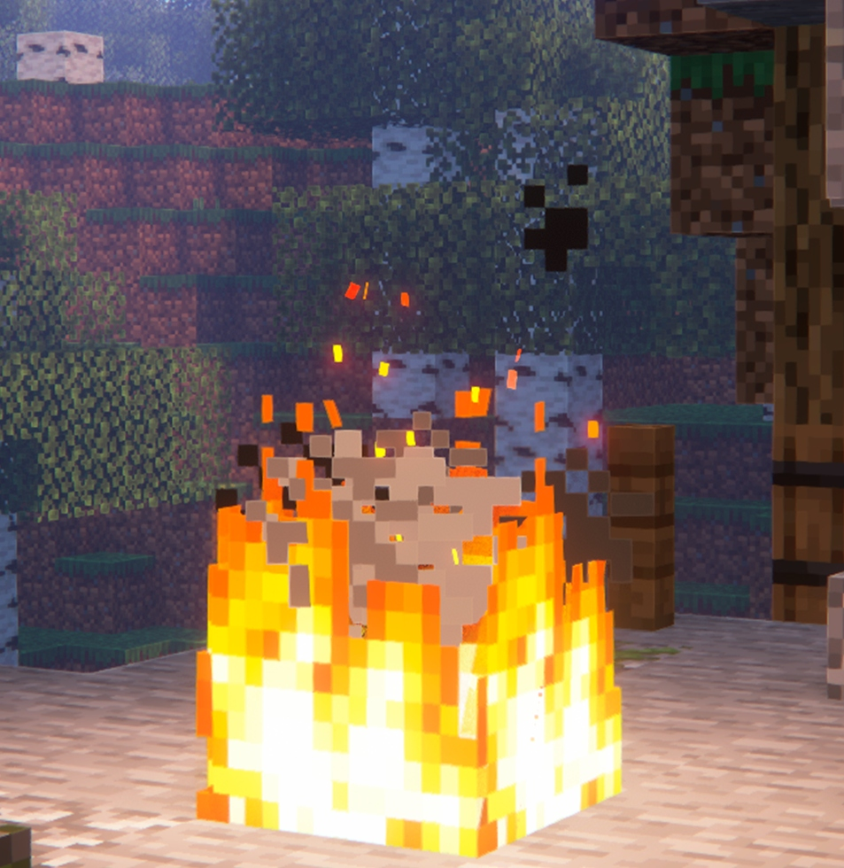

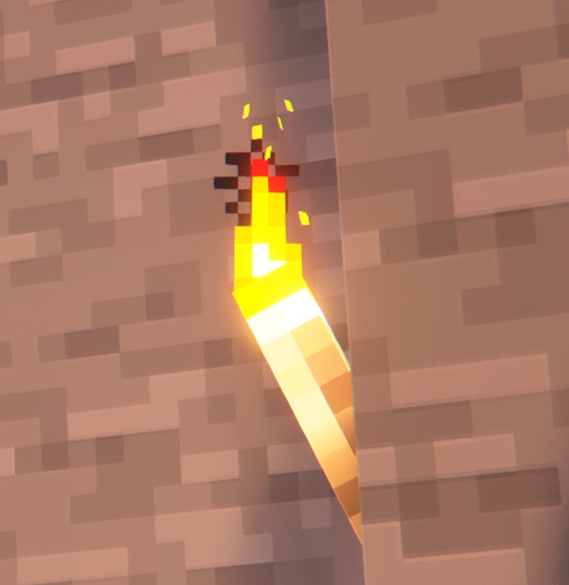

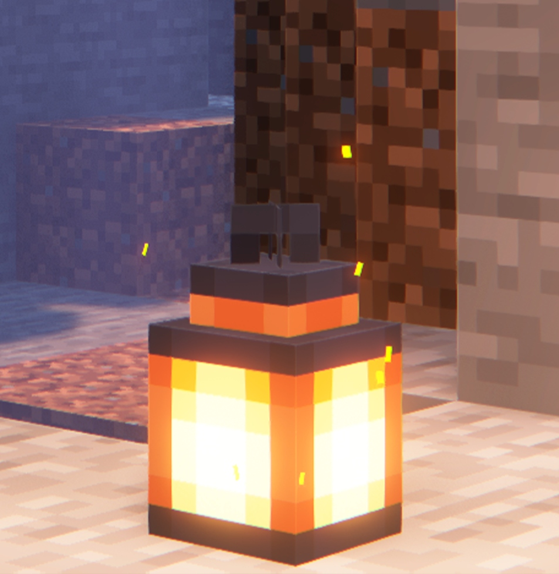

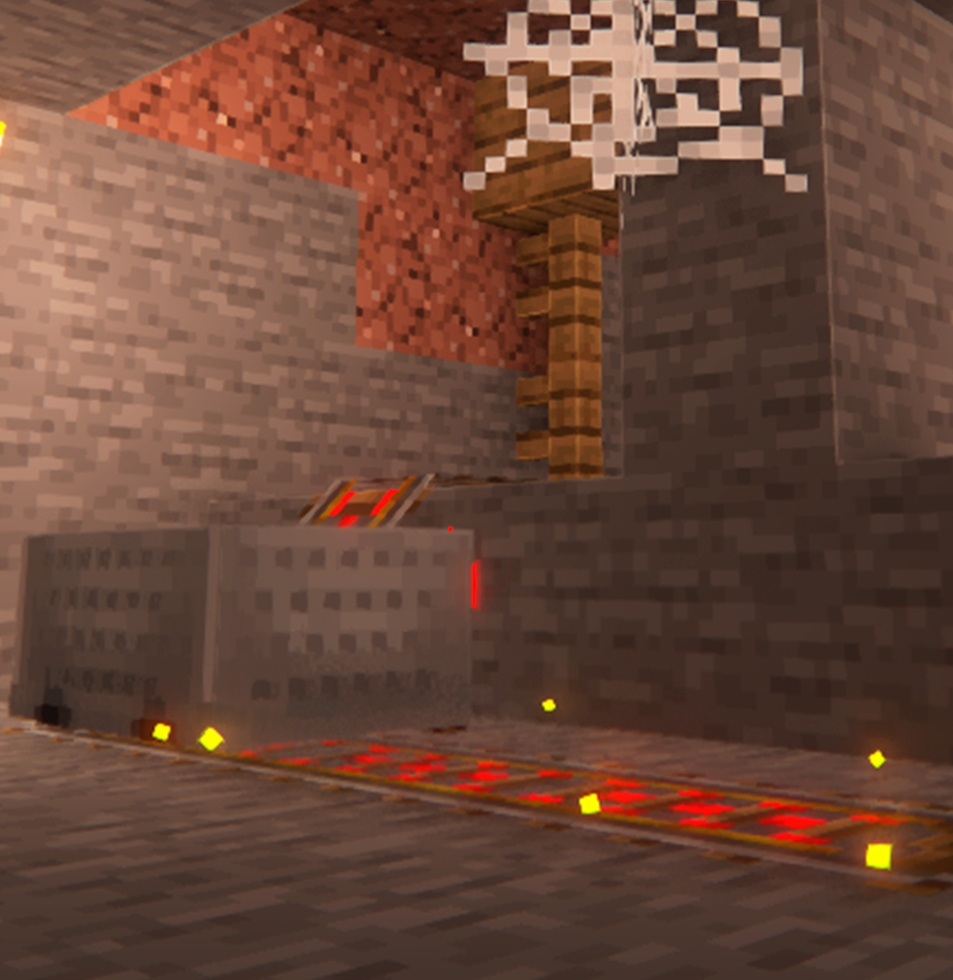

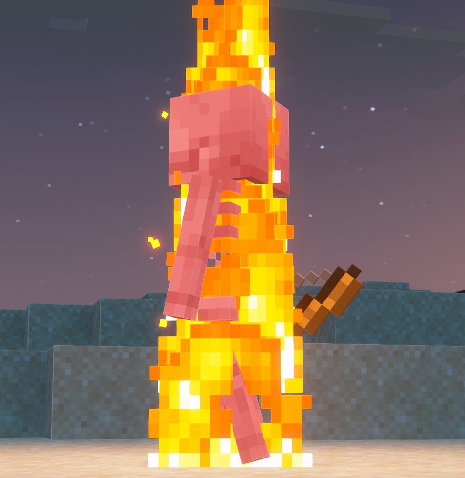

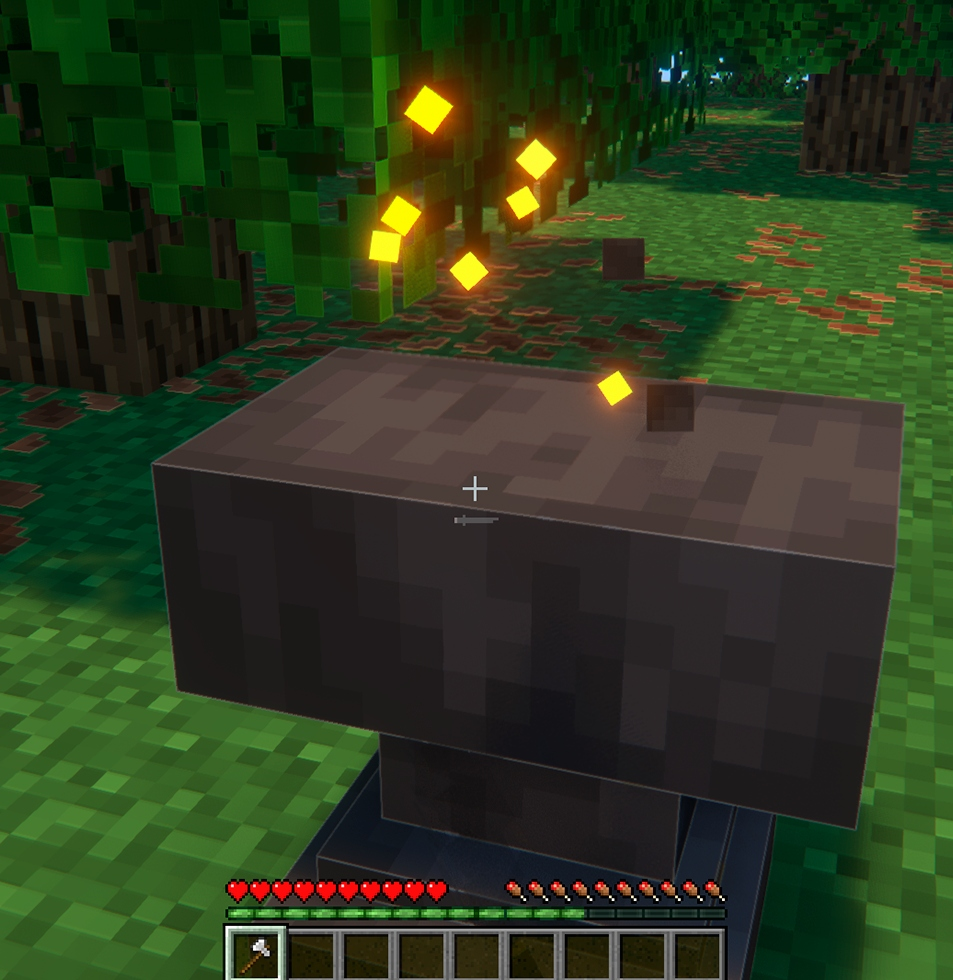

> NOTE The above pictures are from Modrinth showcasing light source sparks, block friction effects, and fiery ember particles from Effectual.

Download :  [Effectual](https://modrinth.com/mod/effectual)

***

## Related

* [Atmosphere overview](overview.md)
* [Weather](weather.md)
* [Visuals: Graphics](../visuals/graphics.md)
