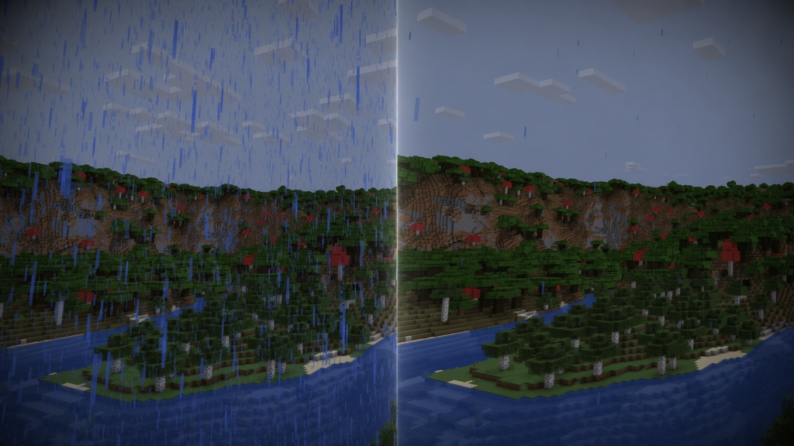
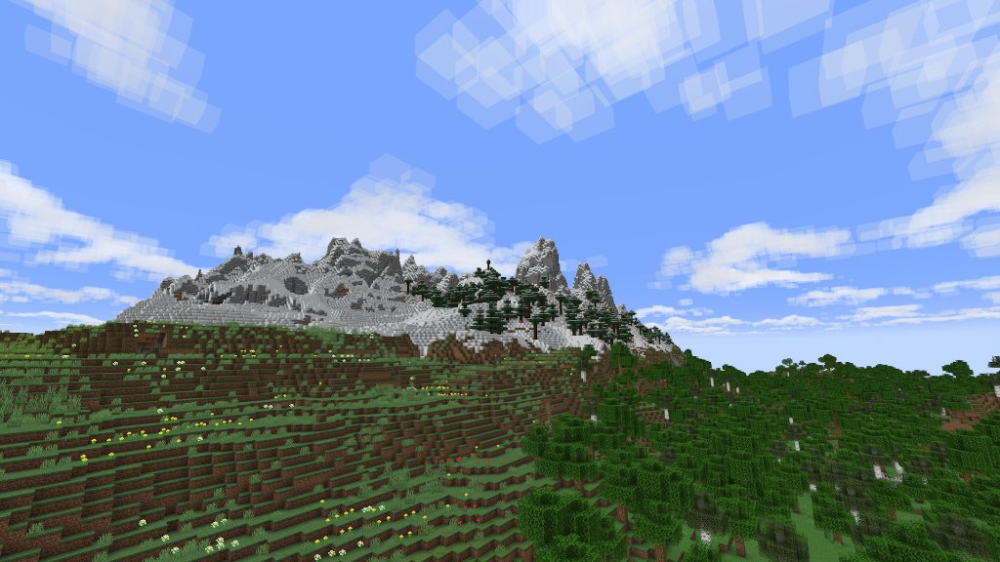
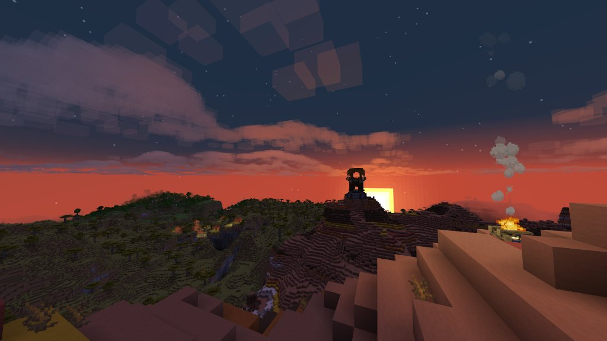
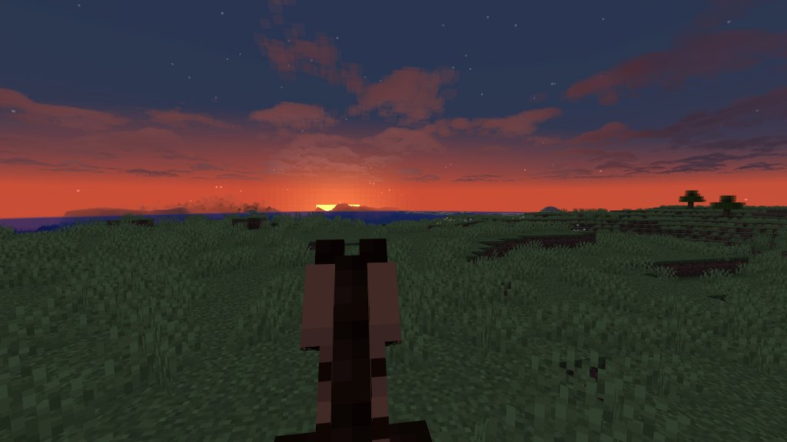
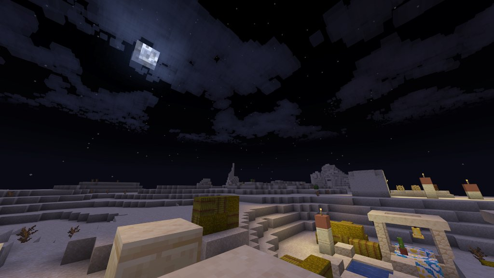
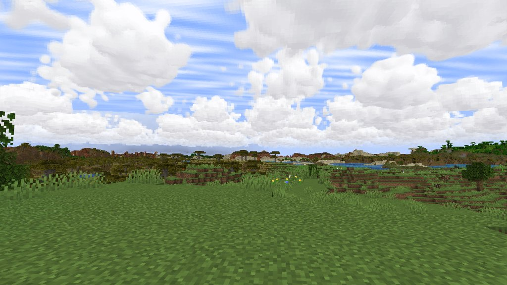
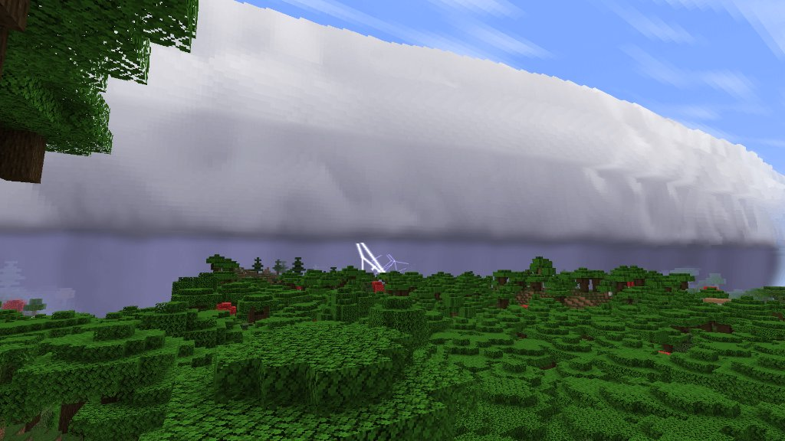
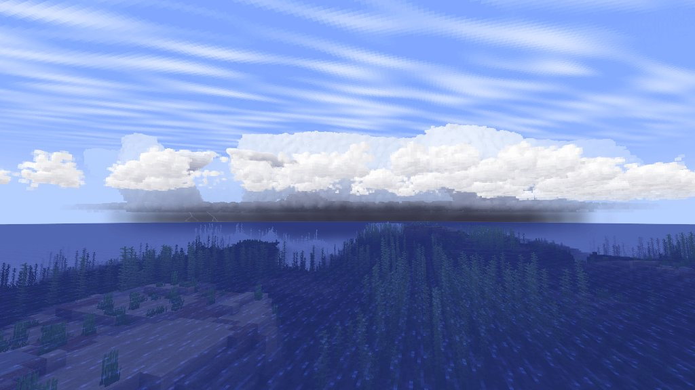
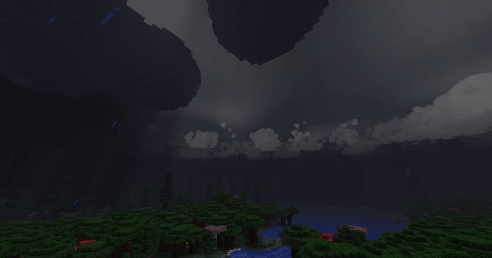

# WEATHER & SKY MODS

> NOTE
> Weather and sky mods overhaul how storms, rain, snow, and clouds appear in Minecraft, making climatic events visually engaging and immersive.

> TIP
> **Better Clouds** and **Simple Clouds** both overhaul cloud rendering. Choose one of them according to your preference; running both at the same time is not recommended.

## 1. WeatherRefind

- Replaces vanilla screen-space rain and snowfall textures with smooth, customizable particle-based weather.
- Eliminates the harsh, blinding visual clutter of vanilla rainstorms while enhancing environmental atmosphere.
- Features gradual fade-in transitions for storms and customizable particle spawn densities and ranges.
- Client-side mod that works on any vanilla or modded server.

> NOTE
> The above picture is from Modrinth showcasing the visual difference between vanilla rain (left) and WeatherRefind (right).

Download :  [WeatherRefind](https://modrinth.com/mod/weatherrefind)

## 2. Better Clouds

- Adds simple, volumetric, multi-layered blocky clouds that seamlessly match Minecraft's authentic vanilla art style.
- Features highly customizable cloud height, layer count, distance, and density settings.
- Built-in support for major rendering and shader mods including Sodium, Iris, BSL, and Complementary.
- Lightweight performance designed to match or outperform vanilla cloud rendering.

> NOTE
> The above pictures are from Modrinth showcasing volumetric multi-layered clouds across biomes, day/night cycles, and flying above the clouds.

Download :  [Better Clouds](https://modrinth.com/mod/better-clouds)

## 3. Simple Clouds

- Cloud rendering overhaul that introduces stylized, real-life-inspired cloud formations such as cumulus, cumulonimbus, and stratus.
- Features large-scale cloud rendering with Level-of-Detail (LOD) performance scaling.
- Introduces localized weather: rain and snow fall only under heavy cloud formations overhead rather than universally across the entire loaded render distance.
- Includes ominous storm fog when situated underneath thunderheads, along with realistic delayed thunder audio effects.

> NOTE
> The above pictures are from Modrinth showcasing stylized cumulus formations, approaching storm shelves, distant rain bands, and localized storm fog.

Download :  [Simple Clouds](https://modrinth.com/mod/simple-clouds)

## 4. Particle Rain

- Completely overhauls vanilla weather by replacing flat, static weather textures with physics-driven particles.
- Rain streaks tilt and fall according to wind direction, while snow particles gently swirl and rotate as they drift down.
- Adds environmental weather phenomena including ground fog during humid conditions, blowing sandstorms and dust in deserts, and surface ripple effects on open water.

Download :  [Particle Rain](https://modrinth.com/mod/particle-rain)

---

## Related

- [Atmosphere overview](overview.md)
- [Ambient](./)
- [Particles](particles.md)
