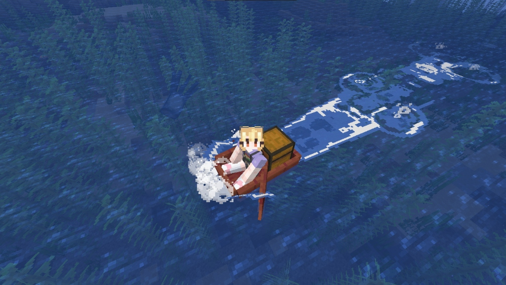
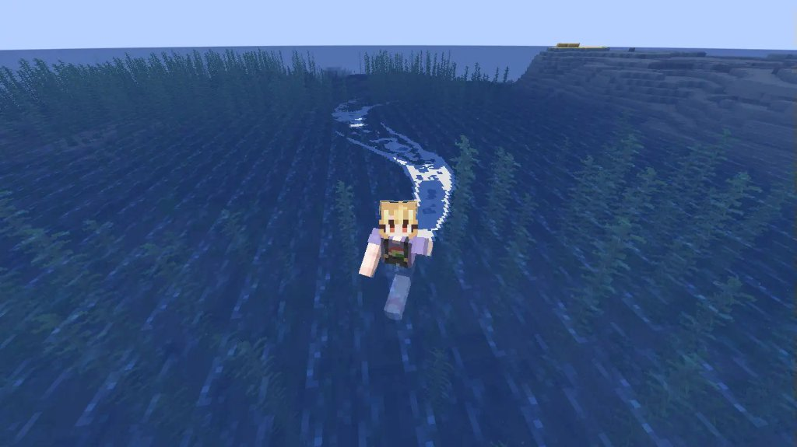

# GRAPHICS & VISUAL EFFECT MODS

> NOTE
> Graphics and visual effect mods enhance client-side rendering, fluid simulations, explosion effects, and interactive visual feedback without replacing vanilla art direction.

> TIP
> All mods in this section are client-side only and compatible with multiplayer servers.

## 1. Wakes Reforged

- Overhauls fluid dynamics visually by rendering dynamic, realistic wakes, ripples, and foam splashes behind boats and swimming entities.
- Wakes dynamically adapt to entity movement velocity and match the local water biome color.
- Built-in compatibility with major shader packs (such as Complementary and BSL) so waves correctly match custom water surface heights and lighting.

> NOTE
> The above pictures are from Modrinth showcasing boat wave trails, foam spray, and swimming ripples from Wakes Reforged.

Download :  [Wakes Reforged](https://modrinth.com/mod/wakes-reforged)

## 2. Explosive Enhancement

- Replaces Minecraft's standard flat explosion sprites with immersive, volumetric explosion particle animations.
- Adds dynamic shockwaves, burning spark debris, and expanding smoke plumes to TNT, Creepers, and Ghast fireballs.
- Features custom underwater blast effects including expanding bubble shockwaves.
- Highly customizable particle counts to suit different performance preferences.

Download :  [Explosive Enhancement](https://modrinth.com/mod/explosive-enhancement)

## 3. Particle Interactions

- Adds instant, tactile visual particle feedback to gameplay actions and interactions that are normally unembellished in vanilla.
- Emits particles when placing blocks, stripping logs with axes, harvesting crops, walking through tall foliage, or cooking items in furnaces.
- Designed strictly to fit vanilla particle styling and fully configurable through in-game config menus.

Download :  [Particle Interactions](https://modrinth.com/mod/particle-interactions)

## 4. Inventory Particles

- Renders subtle, dynamic, and colorful particle effects directly around items inside player inventory and chest menus.
- Makes item hovering, viewing rare gear, and organizing storage screens feel lively and visually responsive.
- Supports both vanilla items and modded items with configurable effect frequencies and styles.

Download :  [Inventory Particles](https://modrinth.com/mod/inventory-particles)

---

## Related

- [Visuals overview](overview.md)
- [Animations](animations.md)
- [Lighting](lighting.md)
- [Atmosphere: Particles](../atmosphere/particles.md)
