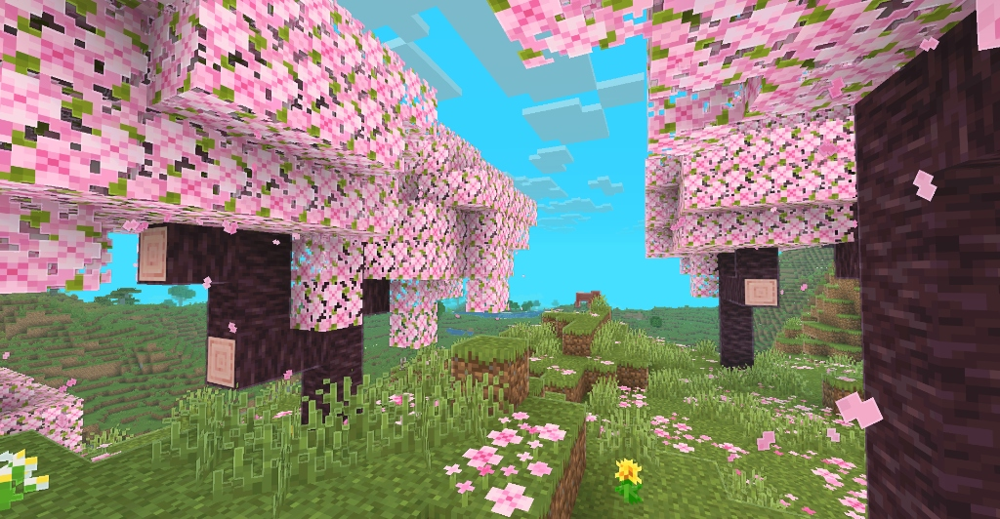
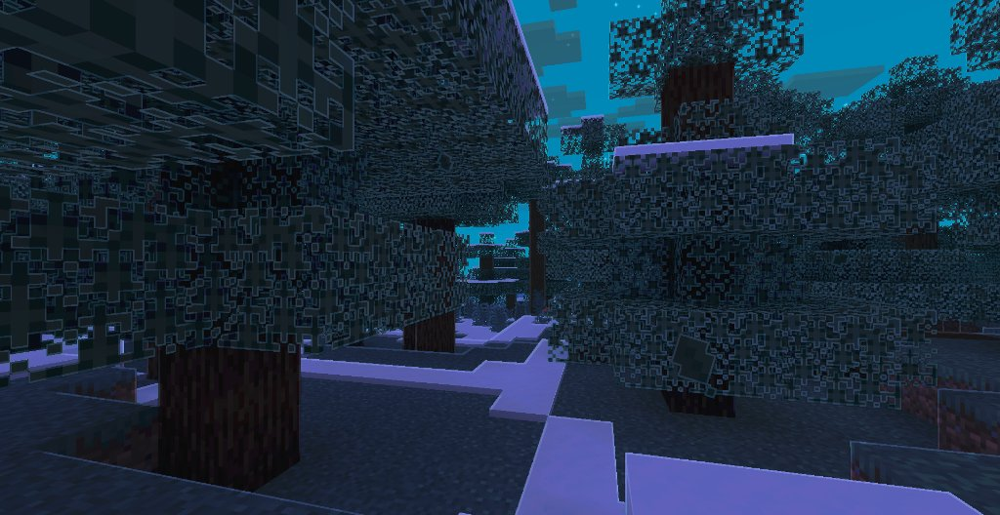
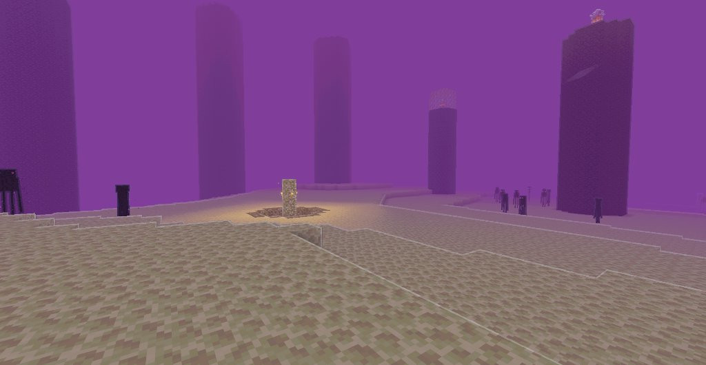

# LIGHTING MODS

> NOTE Lighting mods improve how light spreads, colors the environment, and highlights objects, giving depth to builds, caves, and nighttime landscapes.

> TIP Lightweight lighting mods like **lumaLight** provide vibrant visual effects such as colored light and bloom without demanding the hardware requirements of a full shader pack.

## 1. lumaLight

* A stylized, performance-friendly visual mod that brings colored lighting, selective bloom, texture-aware outlines, and a cel-shaded aesthetic to Minecraft.
* Acts as a lightweight alternative to heavy shader setups, providing glowing light sources, atmospheric lamp tints, and enhanced block outlines.
* Highly customizable post-processing settings that let you toggle bloom intensity, outline sharpness, and lighting hues.

> NOTE The above pictures are from Modrinth showcasing cel-shaded outlines, colored lighting, and bloom in various biomes and dimensions.

Download :  [lumaLight](https://modrinth.com/mod/lumalight)

***

## Related

* [Visuals overview](overview.md)
* [Graphics](graphics.md)
* [Shaders overview](../shaders/overview.md)
